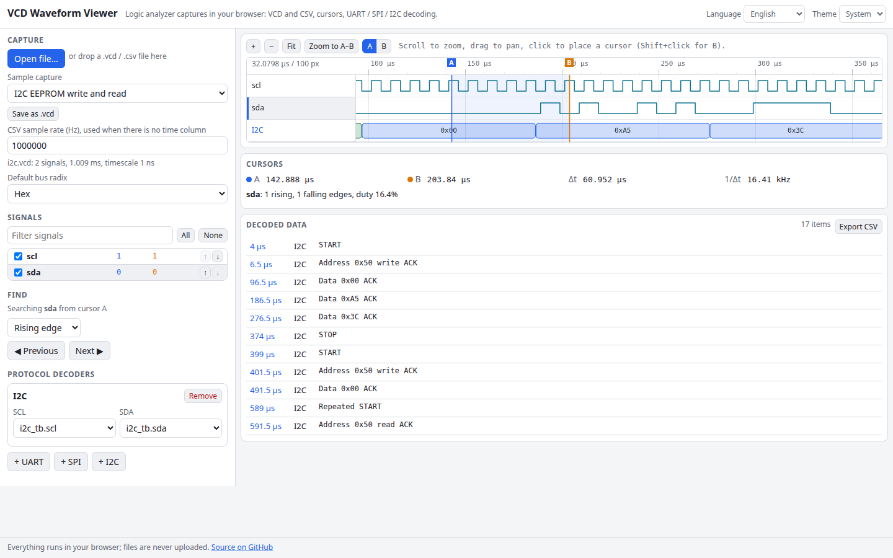

# VCD Waveform Viewer

A logic analyzer viewer that runs entirely in your browser. Open a VCD (Value Change Dump) or CSV capture, zoom and pan the digital signals, read buses in hex or decimal, measure with two cursors, jump between edges, and let the UART, SPI and I2C decoders turn the waveform into bytes. Files never leave your machine.

**Try it: [hermes98761234.github.io/vcd-waveform-viewer](https://hermes98761234.github.io/vcd-waveform-viewer/)**

[](https://github.com/hermes98761234/vcd-waveform-viewer/actions/workflows/deploy.yml)



## Features

- **VCD and CSV.** Standard VCD with scopes, scalars, vectors, reals, aliased id codes and x/z states. CSV with a time column (`Time [s]`, `time_ns`...) or plain samples at a sample rate you choose. Parsing runs in a Web Worker.
- **Canvas waveforms** with wheel zoom around the pointer, drag to pan, pinch on touch screens, a 1-2-5 time ruler and a hover read-out. Dense signals collapse into a shaded band instead of aliasing.
- **Buses** drawn as labelled hexagons in hex, decimal, signed decimal, binary or ASCII, per signal. Real-valued signals are drawn as analog traces.
- **Cursors A and B** with delta time, frequency, and, for the selected signal, edge counts, period and duty cycle between them. Values of every signal at both cursors are listed beside the names.
- **Edge and value search.** Next or previous rising, falling or any edge of the selected signal, or the next time a bus equals `0x1F`, `0b101` or `31`.
- **Protocol decoders.** UART (baud with auto-detect, 5 to 9 data bits, parity, stop bits, bit order, inverted lines, framing and parity errors), SPI (all four modes, optional chip select, MOSI and MISO, word size, bit order) and I2C (START, repeated START, STOP, address with R/W, data, ACK and NACK). Results appear as annotation lanes under the signals and as a table you can click to jump to a byte, and export as CSV.
- **Built-in sample captures**, generated in code: an I2C EEPROM write and read, an SPI flash JEDEC ID read, UART text at 9600 baud and a counter with buses. Any capture, including a converted CSV, can be saved as a `.vcd`.
- **English or Ukrainian, light, dark or system theme.** Settings are remembered in the browser. No backend, no tracking.

## How it works

`parseVcd` reads the header (timescale, scopes, `$var` declarations) and then the value changes line by line. Each signal is stored as two parallel arrays, change times in integer ticks and values as strings, so lookup is a binary search. Vectors are padded to their declared width the way the standard says, and several changes in one tick collapse to the last.

The decoders work on those change lists, not on resampled data. The UART decoder finds each falling start edge and samples the middle of every bit from there. SPI samples on the clock edge selected by CPOL and CPHA and groups bits into words per chip-select assertion. I2C replays the merged SCL and SDA edges through a small state machine: SDA moving while SCL is high is START or STOP, and SCL rising samples a bit.

The decoders are tested against known frames (ASCII `H` is `0x48` LSB first, the JEDEC ID `EF 40 18`, the EEPROM address `0x50` with R/W bit) and every sample capture is round-tripped through the VCD writer.

Not supported: sigrok `.sr` session files, 10-bit I2C addresses.

## Quick start

You need [Node.js](https://nodejs.org/) 22.

```bash
git clone https://github.com/hermes98761234/vcd-waveform-viewer.git
cd vcd-waveform-viewer
npm install
npm run dev       # http://localhost:5173
npm test          # parser, decoders and formatting tests
npm run build     # static site in dist/
```

## License

MIT
